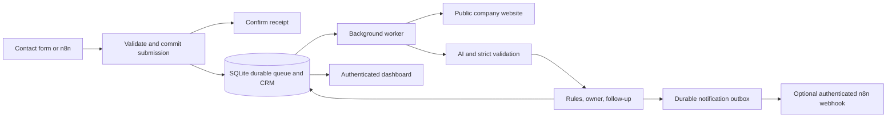

# LeadHarbor

**Every hello. A clear next step.**

LeadHarbor turns inbound inquiries into a manageable sales pipeline: durable capture, safe company website enrichment, evidence-backed AI qualification, a CRM workspace, reviewed reply drafts, and follow-up tracking. n8n connects your existing forms and team notification channels.

The original single-run demo has been replaced by a durable application. **A website or AI failure cannot erase an accepted submission.** The form confirms receipt only after a database transaction commits.

## Start the local demo

Requires Python 3.12 or newer. The application has **no third-party Python dependencies**.

```sh
python3 scripts/setup.py --demo
python3 scripts/seed_demo.py
python3 -m leadharbor
```

Open **http://localhost:8080**. The demo password is `leadharbor-demo-only`. The contact form is at `/contact`. If port 8080 is occupied, set `PORT` and the matching `PUBLIC_URL` in `.env` to an available port.

Demo mode is clearly labeled, uses a separate database, listens only on loopback, and makes **no website, AI, or notification requests**. Its fixture scores are synthetic examples. Do not enter real personal data in the demo.

If `.env` already exists, setup refuses to overwrite it. To switch from demo to a real installation, stop the service, archive the demo `.env` privately, and run setup again without `--demo`. Use a new database and a new password; do not reuse the public demo password.

## Configure a real workspace

```sh
python3 scripts/setup.py
```

Choose a workspace password, then edit `.env` privately:

- Set `LLM_API_KEY`, `LLM_BASE_URL`, and `LLM_MODEL` for your chosen chat-completions provider. Local endpoints are supported; use the provider's required placeholder key if it does not authenticate requests.
- Set your current input/output token prices to enable cost estimates. Missing rates are shown as **unpriced**, not free.
- Edit `config/scoring.json`: your services, ideal customer, thresholds, keyword adjustments, lead owners, follow-up times, daily call limit, and privacy contact.
- For a public installation, set `PUBLIC_URL=https://your-domain`, `SECURE_COOKIES=true`, and `DOMAIN=your-domain`.

Then run `python3 -m leadharbor`, or deploy with Docker. Missing provider configuration leaves submissions safely in `needs_configuration`; configure the provider, restart, and retry them from Recovery.

## What is included

| Area | Behavior |
|---|---|
| Capture | Required-field validation, bounded input, privacy acknowledgment, honeypot, rate limiting, transactional receipt |
| Idempotency | Atomic unique submission keys; conflicting content returns 409; separate inquiries share a normalized-email contact |
| Processing | Durable SQLite queue, exclusive job claims, stale-lease recovery, three attempts by default, manual reprocessing |
| Safe fetching | HTTP(S) only, public-IP validation for every DNS answer, pinned connections, TLS verification, redirect revalidation, size/time/content-type limits |
| Enrichment | HTML parsing, script/style/navigation exclusion, useful-text checks, 24-hour public-page cache, status and source timestamps |
| AI | Strict field/type/score validation, verified verbatim evidence quotes, explicit unknown company facts, low-confidence review |
| Qualification | Configurable deterministic adjustments, hot/warm/cold/review routing, ownership and follow-up deadlines |
| CRM | Search, filters, pagination, inquiry details, owner, notes, stage, follow-up date, scoring feedback |
| Replies | Editable drafts, recorded human approval, copy for manual sending; approval never sends email |
| Recovery | Failed/configuration-blocked leads, durable notification outbox, retry controls, n8n error reports |
| Insights | Qualification distribution, closed-lead win rate, score acceptance, token usage, recorded cost and unpriced calls |
| Operations | Password hashing, expiring/revocable sessions, scoped API tokens, CSRF checks, security headers, retention, CSV formula protection, online backups, CI |

## Architecture



The service owns storage and background processing. n8n is optional for the built-in form; use it for external form orchestration and integrations. SQLite provides a practical deployment for one small team on one machine. This is not a multi-tenant SaaS or a horizontally distributed queue.

## Docker deployment

Docker Engine and **Docker Compose 2.30+** are required (`env_file.format: raw` preserves password hashes literally).

```sh
# Use non-demo configuration before running containers.
docker compose up --build -d app

# Optional local n8n instance:
docker compose --profile n8n up --build -d

# Public HTTPS using Caddy, after DNS points to this host:
docker compose --profile https up --build -d
```

App and n8n host ports bind to loopback. The HTTPS profile exposes the app through Caddy on ports 80/443. n8n remains local unless you deliberately configure a separate authenticated proxy. The app runs as a non-root user with a read-only root filesystem, dropped capabilities, resource limits, and a persistent database volume.

n8n is pinned to `2.47.7`, the stable release returned by the official release API during implementation. Review vendor security updates before deployment. The Python/Caddy images track their maintained release branches; pin image digests in your release process if you require immutable builds.

See [Deployment & operations](docs/OPERATIONS.md) for HTTPS, firewall rules, backups, restoration, monitoring, retention, and upgrading.

## n8n setup

Import [workflow.json](workflow.json). It now contains only:

```text
Lead form → stable submission key → durable API capture → receipt
```

Set the HTTP Header Auth credential on **Save submission durably**:

- Header name: `Authorization`
- Header value: `Bearer <INGEST_TOKEN from your private .env>`

Do not put tokens in workflow JSON or browser JavaScript. Docker uses `http://app:8080`; for a separately hosted n8n, use the app's HTTPS origin. Publish only after customizing the form's privacy notice and business contact.

Optional exports:

- [Notifications](workflows/notifications.json): authenticated webhook and disabled Slack/team-email branches. Credentials and destinations must be supplied before enabling a branch.
- [Error handler](workflows/error-handler.json): records automation failures for the Recovery screen. Select it in the capture workflow's Error workflow setting.

Follow [the full n8n guide](docs/N8N.md), including the narrowly scoped internal-host SSRF allowlist and at-least-once delivery semantics.

## Verify changes

```sh
python3 -m unittest discover -s tests -v
python3 scripts/check_workflows.py
npm ci --ignore-scripts
npm test
npm run check
```

Node 22.22.2+, 24.15+, or 26+ is needed only for development checks. Python tests cover security, persistence, concurrency, worker recovery, providers, HTTP auth, API behavior, deletion, and backups. DOM tests exercise dashboard rendering, login/logout, filters, approval, feedback, follow-up edits, escaping, recovery, and public-form retries. These are not a substitute for a real-browser visual inspection or a live n8n import test.

[API reference](docs/API.md) · [Security design](docs/SECURITY.md) · [Acceptance checklist](docs/ACCEPTANCE.md)

## Repository map

```text
leadharbor/          Python service, worker, security, storage, dashboard and contact form
config/scoring.json Business policy and qualification rules
workflow.json       Primary n8n capture workflow
workflows/          Optional notification and error-handler workflows
scripts/            Setup, backups, export generation and verification
examples/           Synthetic sample API payload
tests/             Backend/API, DOM, and workflow-code tests
compose.yml         App, optional n8n, optional HTTPS proxy
.github/workflows/  Automated checks and container build
```

## Project name

**LeadHarbor** describes the core promise: every inquiry has a safe place to land and a clear route forward. This is a working project name; trademark and domain availability have not been checked.

MIT licensed. Original n8n lead-enrichment workflow by Oleg Naryzhnykh; the original license attribution is preserved in [LICENSE](LICENSE). Existing `demo.gif` and `workflow.png` illustrate the original prototype, not the current app.
